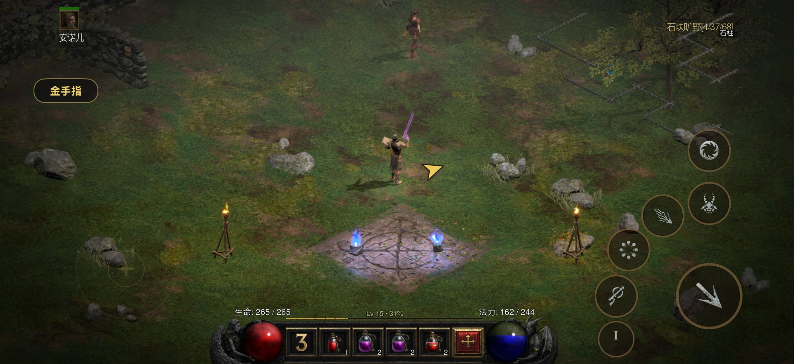
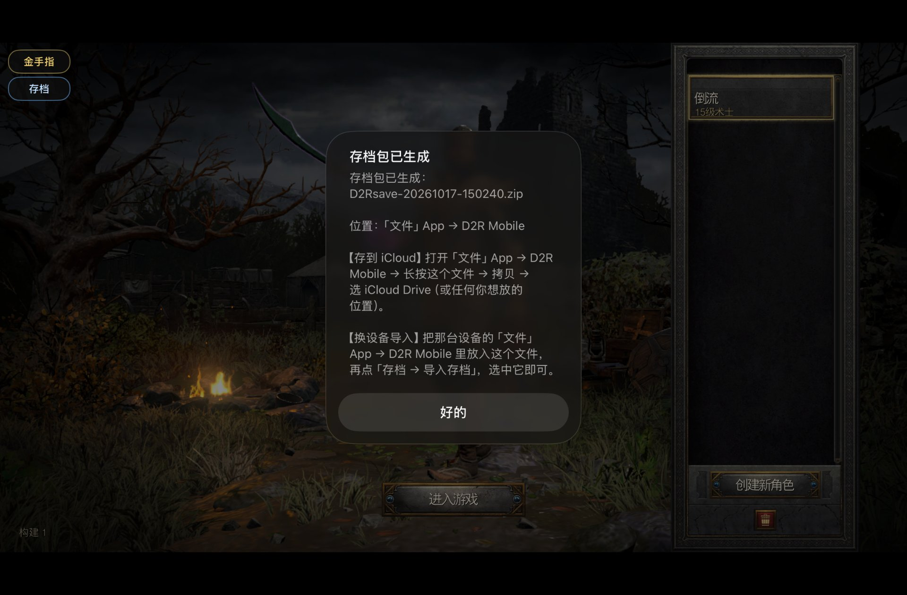
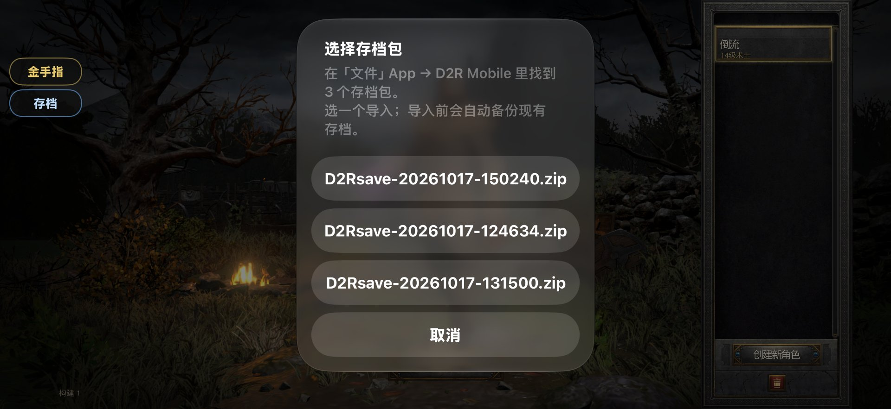
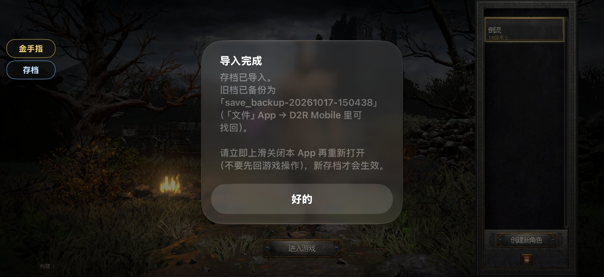
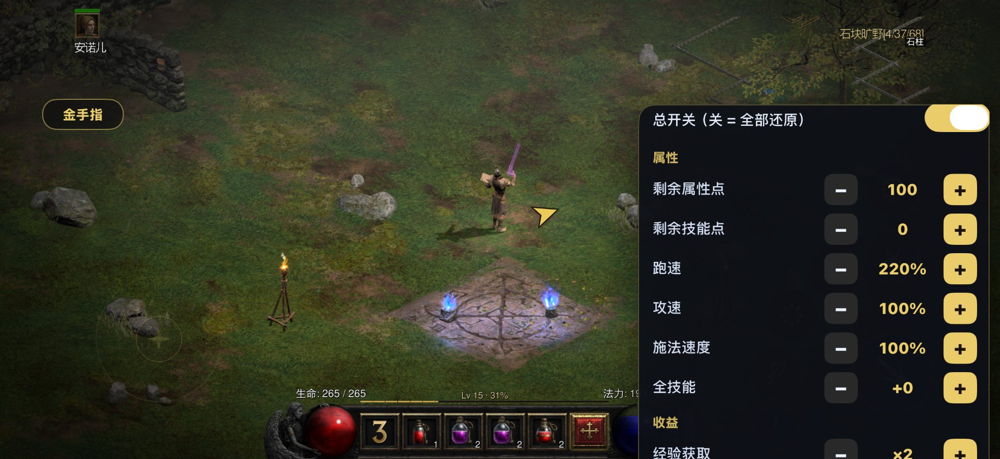
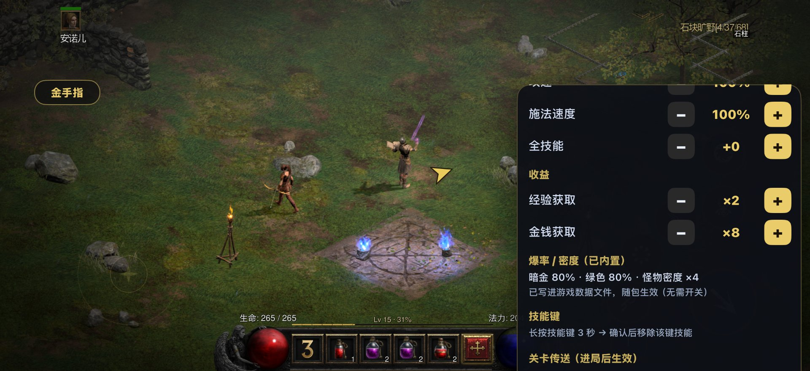

# D2R Mobile iOS 增强模块

给 [**d2r-mobile**](https://github.com/jhaizhou-ops/d2r-mobile)（暗黑破坏神 II：重制版 iOS 移植壳）做的一组**注入式增强模块**，不需要改壳源码、不需要重新签名壳本体，编译成 `dylib` 注入 IPA 即可。

> 本仓库只收录**最终版本（v1.0.16-mods-1l）**的源码。开发期的调试脚本、早期实现与逐版本记录均不在此列。

包含三块功能：

| 模块 | 作用 | 产物 |
|---|---|---|
| **任务路径箭头** | 人物旁悬浮一个箭头，指着本关任务终点；任务做完了指小站 | `dmarrow.dylib` |
| **金手指面板** | 属性点 / 跑速 / 攻速 / 施法速度 / 经验 / 金币 / 关卡传送 / 技能键长按移除 | `dmcheat.dylib` |
| **存档一键搬家** | 导出存档包到「文件」App，换设备一键导入 | 同上（内置） |



---

## 功能详解

### 1. 存档导入导出（跨设备同步）

iPhone 和 iPad 各自是独立沙盒，存档天然不互通。这套功能把存档打成一个 zip，放在 App 的「文件」目录里，你可以用「文件」App 自己搬到 iCloud，换设备再导回来。

| 导出 | 选择存档包 | 导入完成 |
|---|---|---|
|  |  |  |

**导出**：人物选择页点「存档」→【导出存档】→ 后台打包成 `D2Rsave-日期-时间.zip` → 弹窗告诉你文件名 → 打开「文件」App → D2R Mobile → 长按文件 → 拷贝 → 选 iCloud Drive。

**导入**：把 zip 放进目标设备的「文件」App → D2R Mobile → 回游戏点「存档」→【导入存档】→ 弹窗列出找到的包 → 选一个 → **自动备份旧档**（`save_backup-日期-时间`）→ 解压覆盖 → 提示重启 App。

几点设计上的考虑：

- **入口只在主菜单 / 人物选择页出现**，进入关卡自动隐藏 —— 从源头避免游戏运行中读写存档
- 导入前**自动备份**，解压失败**自动回滚**，原存档不会丢
- **不依赖 App 的 iCloud 容器权限**（侧载免费 Apple ID 拿不到），全程走「文件」App 手动搬运
- 解压端有路径穿越校验（拒绝 `../`、绝对路径、反斜杠）

### 2. 金手指面板

左上角常驻按钮，可**拖动到任意位置**（位置记在 `Documents/dmcheat.pos`，重启保留）。




**能改什么**

| 分类 | 项目 | 说明 |
|---|---|---|
| 属性 | 剩余属性点 / 剩余技能点 / 跑速 / 攻速 / 施法速度 / 全技能 | 直接调游戏自己的属性读写函数，即时生效 |
| 收益 | 经验获取 / 金钱获取 | 倍率制 |
| 掉落 | 暗金爆率 / 绿色爆率 / 怪物密度 | **已内置进游戏数据文件**（见下方说明），面板里只读显示 |
| 传送 | 8 个常用关卡快捷点 | 进局后生效 |
| 技能 | **长按技能键 3 秒 → 确认 → 移除该键技能** | 移除后变空位十字，点十字即可重新绑定 |

**为什么「爆率/密度」是内置而不是滑块？**

这两项存在游戏的两张数据表里（`itemratio` / `Levels`）。运行时改表必须先在几 GB 内存里扫描定位，而 iOS 会把闲置内存页压缩存放——一碰就解压、内存暴涨，直接被系统按「内存超限」杀掉（这就是早期版本反复闪退的原因）。

最终方案是**构建期把改好的表写进游戏数据档**（走壳自带的 `romfs_overlay` 覆盖机制），游戏启动时自然读到改好的值。零运行时风险，代价是改档位需要重新出包。

当前内置档位：**暗金 40% / 绿色 40% / 黄金 10% / 蓝装 6%（白装约 4%）/ 怪物密度 ×4**。

> 概率口径：`Chance = (Base − (mlvl−qlvl)/Divisor) × 128`，命中率 `= 128/Chance`，并由 `Min` 兜底。品质按 暗金→绿色→黄金→蓝装 顺序判定、命中即止，所以按**目标占比反推条件概率**：`Min = 128 / 条件概率`。当前 `Base=1`，Min 分别为 320 / 192 / 256 / 213 → 期望 **40 / 40 / 10 / 6**，其余约 4% 为白装。

**总开关**关掉 = 所有运行时修改还原（属性、收益、传送），内置的表数据不受影响。

### 3. 任务路径箭头


- **金色箭头** = 本关任务终点（同屏多个时取最近的那个）
- **蓝色箭头** = 任务做完了没有终点时，改指本关小站
- 悬浮在人物旁固定距离，跟着人物走、旋转指向目标
- 快走到目标跟前自动隐藏
- 配置文件 `Documents/dmarrow.cfg`：`mode=player`（人物旁）/ `mode=edge`（贴屏幕边），`wp_fallback=0` 可关掉小站兜底

---

## 版本说明

当前版本 **v1.0.16-mods-1l**（2026-10-17）

**本版包含**

| 模块 | 状态 |
|---|---|
| 任务路径箭头 v1.0g | 人物旁悬浮单主箭头；任务完成后改指本关小站 |
| 金手指面板 1l | 属性 6 项 / 收益 2 项 / 8 个传送点 / 技能键长按 3 秒移除 / 按钮可拖动 |
| 存档一键搬家 | 导出到「文件」App、导入自动备份回滚（跨设备同步） |
| 爆率·密度 | 构建期写入数据档覆盖层（暗金 40% / 绿色 40% / 黄金 10% / 蓝装 6%；密度 ×4） |

### 存档格式

导出的 zip 是 **stored（不压缩）** 格式、UTF-8 文件名，PC 上直接用系统压缩工具就能打开查看。

---

## 目录结构

```
.
├── README.md / LICENSE / .gitignore / .gitattributes
├── arrow/                          # 任务路径箭头模块（dmarrow.dylib）
│   ├── src/                        # dmarrow.c · dmq_geom.c/.h · mock_main.c（几何自测）
│   └── tools/                      # build.py · bindmap.py · extract_syms.py · inject_dylib.py
├── cheat/                          # 金手指 + 存档搬家（dmcheat.dylib）
│   ├── src/                        # dmcheat.c/.h · dmcheat_ui.c · dmsave.m/.h
│   │                               # dmskill.c · dmzip.c/.h
│   ├── tools/                      # build_cheat.py · make_rates_overlay.py · verify_overlay.py
│   │                               # check_final_ipa.py · inject2.py · test_dmzip.py
│   │                               # casc_overlay_local.py
│   └── tests/                      # dmzip_test.c
├── tools/                          # 跨模块工具
│   ├── cheat_scan.py               # 离线扫描游戏资源包，定位 itemratio / Levels 的压缩块
│   └── setenv.sh                   # 构建环境变量（路径需按本机修改）
└── docs/
    ├── 使用说明（最终版）.txt       # 完整操作手册（安装 / 三大功能 / 配置 / 排错）
    └── images/                     # README 用到的 6 张截图
```

---

## 构建

**环境要求**

- Windows + [LLVM/Clang](https://releases.llvm.org/)（交叉编译 `arm64-apple-ios18.0`）
- Python 3.10+
- 原版 IPA（本项目的模块注入到 `Payload/DmIOS.app/DmIOS`）
- iPhoneOS SDK 的 `.tbd` 符号声明（用于发版前的符号审计，放在 `arrow/tools/ios27_tbds/`）

**注意**：脚本里的路径常量是按原作者环境硬编码的（`IPA_SRC`、`ARROW_DYLIB` 等），用之前请改成本机实际路径。

```bash
# 箭头（只出 dylib）
cd arrow && python tools/build.py

# 金手指 + 存档（含覆盖层生成、双库注入，直接出成品 IPA）
cd cheat && python tools/build_cheat.py
```

两个构建脚本都会自带校验：

- **符号审计**：所有导入符号逐个对照 iPhoneOS 27 官方 `.tbd`
- **绑定校验**：0 个 flat 查找（否则 dyld 装载期就会崩）
- **注入校验**：LC 唯一、除头部外无多余字节差异、包内文件字节一致
- **成品校验**：与原始 IPA 逐条目 CRC 比对（只该改的才改）

**ZIP 模块自测**

```bash
cd cheat && python tools/test_dmzip.py
```

---

## 使用

1. 用 [Sideloadly](https://sideloadly.io/) 把构建好的 IPA 装到设备（免费 Apple ID 即可，本模块不依赖 iCloud 容器权限）
2. 把手机资源包（游戏资源）按壳的说明放进 App 沙盒
3. 启动游戏，左上角会出现「金手指」「存档」两个按钮

> 完整操作手册见 [`docs/使用说明（最终版）.txt`](docs/使用说明（最终版）.txt) —— 安装步骤、面板每一项的用法与取值范围、存档搬家全流程、配置文件说明、故障速查表。

---

## 已知限制

- **仅离线角色**：所有修改都是本地行为，不涉及战网
- **爆率/密度改档位要重新出包**（构建期烘焙，不是运行时开关）
- **存档导入后必须彻底关闭 App 再打开**才生效
- **技能键长按移除**在多指同时操作时可能不触发（iOS 长按识别会被第二根手指取消）
- **箭头只指向壳能识别的任务物件**（45 类任务目标），非任务类的目标不会显示
- 壳升级后 `DmIOS` 的符号地址可能变化，需要重新跑 `extract_syms.py`

---

## 致谢

**本项目的全部工作，都建立在 jiang 大佬的开源项目之上：**

> **[jhaizhou-ops/d2r-mobile](https://github.com/jhaizhou-ops/d2r-mobile)** —— 暗黑破坏神 II：重制版 iOS 移植壳

没有这个壳，就没有触摸层、没有文件虚拟化、没有渲染管线，也就没有任何注入的可能。本仓库只包含**在壳之上做扩展的注入模块**，不包含壳的源码、游戏本体资源或 IPA 成品。

同时感谢壳里已经踩平的这些坑，本项目的实现直接受益于它的设计：

- `gate_obs_set` / `gate_obs_present` 观测门（金手指的拍门链挂钩靠它）
- `skillKeyAt:empty:` 触摸层命中接口（技能键移除靠它）
- `romfs_overlay` 数据档覆盖机制（爆率/密度烘焙靠它）
- `dm_map_goals` 任务终点视图（箭头的数据源）
- `dm_world.c` 里一整套世界结构读法（箭头的小站兜底照抄）

---

## 免责声明

- 本项目仅供**个人学习、研究与单机离线使用**
- 不包含游戏本体、游戏资源或任何商业素材，使用前请自备**正版游戏**
- 请勿用于商业用途、联机作弊或任何违反游戏服务条款的场景
- 因使用本项目产生的任何后果由使用者自行承担

---

## License

MIT
